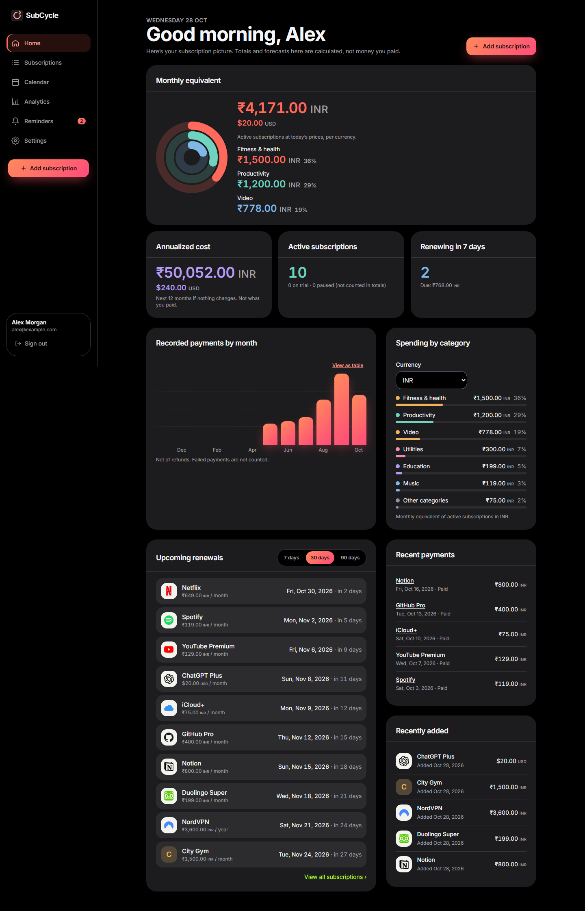
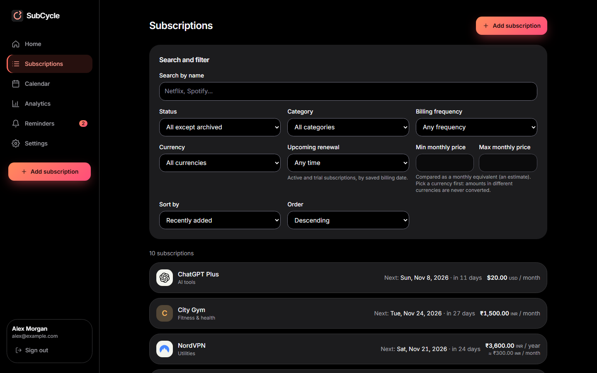
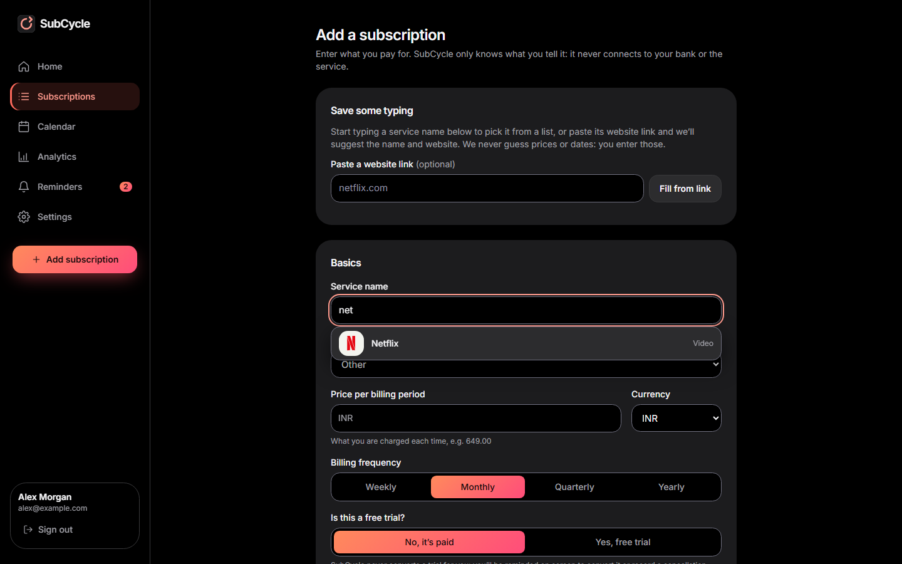
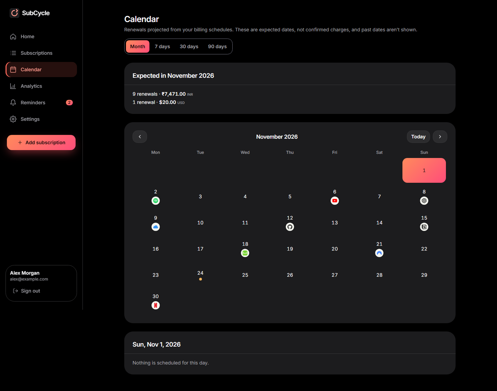
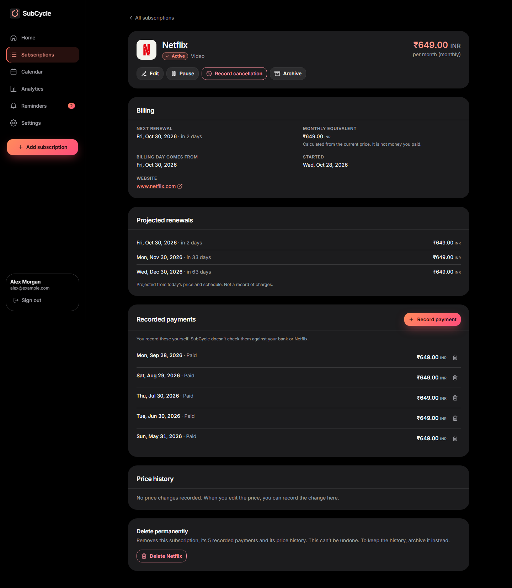
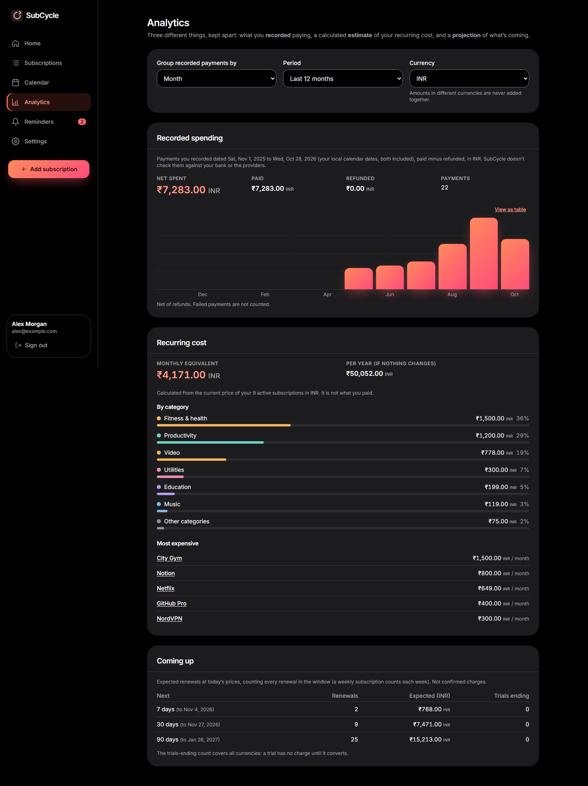
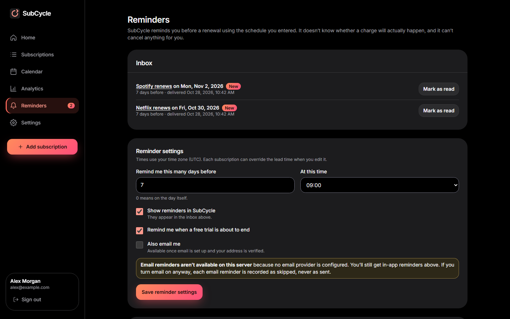
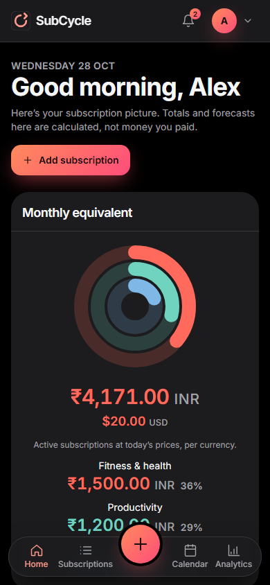
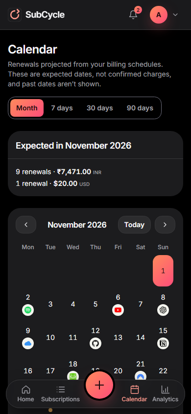

<div align="center">

# SubCycle

**All your subscriptions. One clear picture.**

A private subscription tracker that shows what you pay, when it renews and what it adds up to, and reminds you before it happens. It only knows what you type in: no bank connection, no data sharing.

[](https://github.com/SoubhagyaO2/Sub-Tracker/actions/workflows/ci.yml)




<sub>All screenshots show made-up demo data.</sub>

</div>

## What you get

- **See the whole picture.** Monthly equivalent, yearly total, how spending splits across categories, and what renews in the next 7, 30 or 90 days.
- **Add a subscription in seconds.** Start typing a service name and pick it from a list of about 90 well-known services, or paste its website link and SubCycle suggests the name and site. It never guesses a price or a date: you enter those.
- **Real logos.** Netflix, Spotify, YouTube, GitHub and about 60 other services show their logo (bundled with the app, never fetched from the internet). Anything else can have a picture you upload yourself, or a clean letter tile.
- **Record what you actually paid.** Log payments (paid, failed or refunded) and see them by month. SubCycle warns you before you record the same renewal twice, and keeps a history of price changes.
- **A renewal calendar.** A month grid with each subscription's logo on its renewal day, plus 7, 30 and 90-day views.
- **Reminders before you are charged.** In-app reminders at the lead time and hour you choose, including when a free trial is about to end. Email reminders switch on only when an email provider is configured, and are never reported as sent when they were not.
- **Several currencies, never mixed.** Each currency is totalled on its own; nothing is converted or added across currencies.
- **Yours to take away.** Export your subscriptions and payments as CSV (API) and delete your account and all its data at any time.

### What it is not

SubCycle holds only data you type in. It does not connect to banks, cards or providers, it cannot see what you were really charged, and it cannot cancel anything for you: "cancelled" is your own record. Totals and forecasts are calculated from the prices you entered, not from money that moved.

## A look around

<table>
  <tr>
    <td width="50%"><br><sub><b>Subscriptions.</b> Search, filter by status, category, currency or price, and sort.</sub></td>
    <td width="50%"><br><sub><b>Quick add.</b> Type-ahead suggestions and a paste-a-link lookup fill in the name, category and website.</sub></td>
  </tr>
  <tr>
    <td width="50%"><br><sub><b>Calendar.</b> Logos mark each renewal day; pick a day to see what is due.</sub></td>
    <td width="50%"><br><sub><b>Detail.</b> Billing, projected renewals, recorded payments and price history in one place.</sub></td>
  </tr>
  <tr>
    <td width="50%"><br><sub><b>Analytics.</b> Recorded spending is kept separate from calculated costs and forecasts.</sub></td>
    <td width="50%"><br><sub><b>Reminders.</b> An inbox plus your lead time, time of day and trial-ending alerts.</sub></td>
  </tr>
</table>

<p align="center">
  
  &nbsp;&nbsp;&nbsp;
  
  <br><sub>Built for phones too: a floating bottom bar with a central "+" button, and every page works down to 320&nbsp;px wide.</sub>
</p>

## Designed to be trustworthy

- **Honest numbers.** What you recorded paying, what is calculated from current prices and what is forecast are never blended. Money is stored as whole minor units (paise, cents), never floating point.
- **Private by design.** Passwords are hashed with Argon2, sessions are HttpOnly cookies, state-changing requests need a custom header, sign-in and other sensitive routes are rate limited, and the page runs under a strict Content-Security-Policy. The "paste a link" lookup refuses private, loopback and cloud-metadata addresses, so it cannot be used to probe your network. Details in [docs/SECURITY.md](docs/SECURITY.md).
- **Accessible.** Keyboard operable throughout, visible focus, text alternatives for every chart (with a table view), and colour is never the only signal. Every page and dialog is checked with axe for contrast and structure in a real browser at 320, 390, 820 and 1280 px.
- **Tested end to end.** Unit and integration tests run against a real PostgreSQL, and a Playwright suite drives the built app, API and database in a real browser on every pull request.

## Quick start

Requirements: **Node 24.15 or newer** (see `.nvmrc`), npm 10+, and Docker (for PostgreSQL).

```bash
git clone https://github.com/SoubhagyaO2/Sub-Tracker.git subcycle && cd subcycle
nvm use                      # or any Node satisfying the range above
npm ci
cp .env.example .env         # development defaults; edit nothing for a local run
npm run db:up                # PostgreSQL 16 in Docker on 127.0.0.1:5434; creates `subcycle` and `subcycle_test` (the second only on a brand-new volume; on an existing one run `npm run db:reset`, which DELETES the local development data)
npm run migrate              # applies apps/api/migrations to the development database
npm run dev:api              # API on http://localhost:3001  (terminal 1)
npm run dev:web              # web app on http://localhost:5173 (terminal 2)
```

Open <http://localhost:5173> and create an account. No email provider is configured by default, so email verification and email reminders are reported as unavailable (never as "sent"). Everything else works.

## Built with

| | |
|---|---|
| **Web** | React 19, TypeScript, Vite, Tailwind CSS 4, React Router. Hand-built accessible components and SVG charts |
| **API** | Express 5, TypeScript, PostgreSQL (plain SQL migrations), Argon2, Pino logging, Nodemailer |
| **Shared** | Zod schemas and date/money logic used by both the API and the web app, so they cannot disagree |
| **Tests** | Vitest, Supertest and Testing Library; Playwright with axe-core for the browser suite |

```
apps/api         Express API, SQL migrations, background reminder scheduler
apps/web         React single-page app
packages/shared  Zod schemas and domain logic shared by both
e2e              Playwright browser tests (real API, real database)
docs             Specification, API, data model, security, operations, deployment
scripts          Brand-logo generator, backup/restore verification
```

## Checks

```bash
npm run typecheck && npm run lint && npm run build
npm test                     # API + web unit/integration tests against the disposable `subcycle_test` database
npm audit
```

Browser tests (Playwright, real built API + real PostgreSQL, Chromium):

```bash
npx playwright install chromium     # once
npm run test:e2e                    # builds, starts the API and web servers itself, creates the `subcycle_e2e` database
```

See [docs/TESTING.md](docs/TESTING.md) for environment variables, safety rules and CI, and [docs/RELEASE.md](docs/RELEASE.md) for production readiness. `node scripts/verify-backup-restore.mjs` proves a dump/restore round trip on throwaway databases.

## Running it for real

SubCycle is meant to be self-hosted privately. [docs/DEPLOYMENT.md](docs/DEPLOYMENT.md) is a checklist for a private single-server setup (environment, reverse proxy, a backup plan to implement) and [docs/OPERATIONS.md](docs/OPERATIONS.md) covers day-to-day running. Nothing is deployed by this repository.

## Documentation

| Read this | To learn |
|---|---|
| [SPEC](docs/SPEC.md) | What the product does and why, feature by feature |
| [DESIGN_SYSTEM](docs/DESIGN_SYSTEM.md) | The look: colours, type, components, layouts, accessibility |
| [FRONTEND](docs/FRONTEND.md) | How the web app is built |
| [API](docs/API.md) | Every endpoint, request and error shape |
| [DATA_MODEL](docs/DATA_MODEL.md) | Tables, constraints and migrations |
| [SECURITY](docs/SECURITY.md) | The protections in place and the known gaps |
| [OPERATIONS](docs/OPERATIONS.md) · [DEPLOYMENT](docs/DEPLOYMENT.md) | Running, backing up and hosting it |
| [TESTING](docs/TESTING.md) · [RELEASE](docs/RELEASE.md) | The test suites, CI and production readiness |

## Third-party artwork

Brand logos shown for well-known services come from [Simple Icons](https://simpleicons.org) and [SVG Logos](https://github.com/gilbarbara/logos) (both CC0-1.0, dev dependencies, bundled at build time; nothing is loaded from the network). They are trademarks of their respective owners and appear only to identify the service a user tracks; SubCycle is not affiliated with or endorsed by any of them. See [docs/FRONTEND.md](docs/FRONTEND.md#brand-logos).
