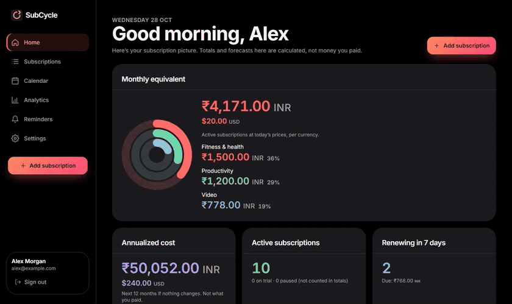
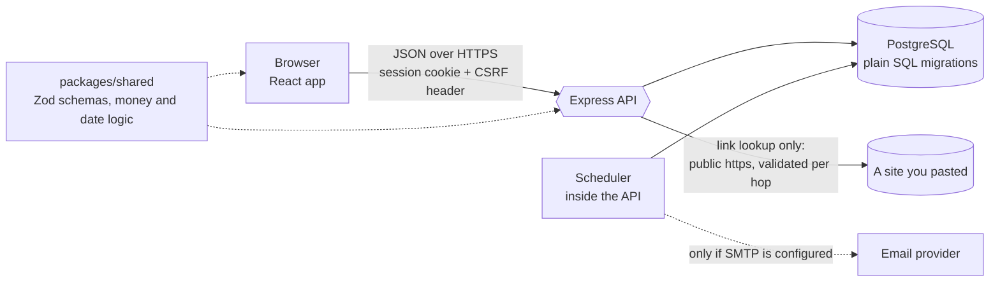

# SubCycle

Track what you subscribe to, see what it costs and when it renews, and get reminded before you are
charged. It only knows what you type in, so there is no bank connection and nothing is shared.



*A real run (27 s, made-up demo data, recorded by Playwright against the built app). A
[full-quality video](docs/media/demo.mp4) is in the repository.*

SubCycle is a self-hosted web app. You add each subscription (a name, a price, how often it bills
and the next billing date); it works out the monthly and yearly cost, lists what renews next,
shows a renewal calendar, and keeps a separate record of the payments you log. Reminders arrive
in the app before a renewal or the end of a free trial, and by email if you configure an email
provider. It ships as an Express API, a React web app and a PostgreSQL schema.

**What it is not.** SubCycle holds only data you type in. It does not connect to banks, cards or
providers, it cannot see what you were actually charged, and it cannot cancel anything for you:
"cancelled" is your own record. Amounts in different currencies are never added together and nothing
is converted.

## Verified results and limitations at a glance

| Verified (2026-10-28) | Not established |
|---|---|
| 1,208 API tests (real PostgreSQL), 403 web tests and 56 real-browser tests pass; all three CI jobs passed on pull request #2 (Ubuntu 24.04, Node from `.nvmrc`) | Behaviour under real load: no performance or concurrency measurements were made |
| Every page and dialog passes axe-core (contrast, structure, names) in Chromium at 320, 390, 820 and 1280 px, with no horizontal overflow and keyboard-only flows covered | A manual screen-reader pass, and Firefox or Safari (WebKit): only Chromium was tested |
| Money is stored as whole minor units (paise, cents); currencies are totalled separately and never combined (tested on dashboard and analytics) | That the numbers match what you were really charged: SubCycle cannot know, so calculated figures are labelled as such and recorded payments are only what you entered |
| The pasted-link lookup refused loopback, private and link-local (cloud-metadata) addresses, decimal, hex and octal IP spellings, internal-looking names, non-https schemes, and names that resolve to a private address; uploaded pictures are checked against the file's own header | Email delivery: it was tested with an in-process fake mailer, never against a real SMTP provider, so email stays off until you verify one |
| `npm audit` reported 0 vulnerabilities; the lint, typecheck and build steps are clean | A production deployment: nothing is deployed, and the backup schedule in the deployment guide is a plan to implement, not something that runs |


**Before you try it:**

- **There is no password reset, email change or multi-factor sign-in**, and sessions cannot be
  listed. A lost password with no open session needs the operator to intervene. Registration is open
  unless you restrict access at your reverse proxy.
- **Run one API process.** Rate limits are kept in memory, per process, and the guarantees about
  the reminder scheduler assume a single instance.
- **Reminders only run while the API runs.** After downtime, reminders still before their renewal
  date are delivered late; ones that would arrive after the renewal are recorded as missed, never as
  sent.
- **The app is dark only.** There is no light theme and no theme setting.
- **The "paste a link" lookup needs outbound HTTPS** from the API host. If egress is blocked it
  falls back to a name taken from the address; it never blocks the form.
- **Local verification ran on Node 24.13.0 (Windows 11)**, not the pinned 24.15.0. The pinned version
  was exercised by CI on Linux.

## What is in the box

| Part | Where | What it does |
|---|---|---|
| Web app | `apps/web/` | Dashboard, subscription list and detail, add/edit form with type-ahead and link lookup, renewal calendar, analytics, reminders inbox, settings. React 19, Vite, Tailwind CSS 4 |
| API | `apps/api/` | Sign-up and sessions, subscriptions, payments and price history, calendar, analytics, reminders, link lookup, picture upload, CSV export. Express 5 on PostgreSQL |
| Scheduler | `apps/api/src/scheduler` | Runs inside the API: rolls stale billing dates forward, plans and delivers reminders, purges expired sessions |
| Shared code | `packages/shared/` | Zod schemas, date and money logic, and the built-in service list, used by both the API and the web app so they cannot disagree |
| Browser tests | `e2e/` | Playwright against the built API and web app and a real database, with axe-core on every page |
| Scripts | `scripts/` | Brand-logo generator, backup and restore verification |

## Screens

<table>
  <tr>
    <td width="50%"><br><sub><b>Subscriptions.</b> Search, filter by status, category, currency or price, and sort.</sub></td>
    <td width="50%"><br><sub><b>Quick add.</b> Type a name and pick a service; or paste its website link.</sub></td>
  </tr>
  <tr>
    <td width="50%"><br><sub><b>Calendar.</b> Each renewal day shows the subscription's logo.</sub></td>
    <td width="50%"><br><sub><b>Detail.</b> Billing, projected renewals, recorded payments and price history.</sub></td>
  </tr>
  <tr>
    <td width="50%"><br><sub><b>Analytics.</b> Recorded spending, kept apart from calculated cost and forecasts.</sub></td>
    <td width="50%"><br><sub><b>Reminders.</b> An inbox, your lead time and hour, and trial-ending alerts.</sub></td>
  </tr>
</table>

<p align="center">
  
  &nbsp;&nbsp;&nbsp;
  
  <br><sub>On a phone: a floating bottom bar with a central "+" button. Every page works down to 320&nbsp;px wide.</sub>
</p>

## Architecture



The browser never talks to anything but the API. The shared package defines every request and
response shape once, so the API and the web app validate against the same schemas. Details:
[`docs/SPEC.md`](docs/SPEC.md), [`docs/API.md`](docs/API.md), [`docs/DATA_MODEL.md`](docs/DATA_MODEL.md).

## Quick start

Requires Node 24.15 or newer (see `.nvmrc`), npm 10+ and Docker (for PostgreSQL). Everything else is
installed by `npm ci`.

```bash
git clone https://github.com/SoubhagyaO2/Sub-Tracker.git subcycle && cd subcycle
nvm use                      # or any Node satisfying the range above
npm ci
cp .env.example .env         # development defaults; edit nothing for a local run
npm run db:up                # PostgreSQL 16 in Docker on 127.0.0.1:5434; creates `subcycle` and `subcycle_test` (the second only on a brand-new volume; on an existing one run `npm run db:reset`, which DELETES the local development data)
npm run migrate              # applies apps/api/migrations to the development database
npm run dev:api              # API on http://localhost:3001  (terminal 1)
npm run dev:web              # web app on http://localhost:5173 (terminal 2)
```

Open <http://localhost:5173> and create an account. No email provider is configured by default, so
email verification and email reminders are reported as unavailable (never as "sent"). Everything else
works.

## Adding subscriptions quickly

On the **Add subscription** page you can start typing a service name and pick it from a built-in
list of about 90 well-known services, which fills in the name, category and website. Or paste a
website link and click **Fill from link**. Known services are recognised in the browser; for any
other address the API fetches the page to read its title. **Price and dates are never guessed:**
you always enter those. About 60 services show their real logo (bundled with the app, never loaded
from the network); anything else gets a letter tile, or a picture you upload yourself.

What protects the server (each point has automated tests):

- **The lookup can only reach public websites.** https on port 443 only, no credentials in the URL,
  IP-address hosts and internal-looking names refused before any lookup. Every address a name
  resolves to must be globally routable (loopback, private, link-local and cloud-metadata, shared
  and reserved ranges are refused), and the check runs inside the connection's own DNS lookup so a
  name cannot change its answer between check and connect.
- **Redirects are followed by hand**, at most 3, and every hop is validated again.
- **Small and quiet.** 4 s timeout, 256 KB cap, HTML only, no cookies or referrer sent, 20 lookups
  per user per minute, the address is neither logged nor stored, and every refusal uses one fixed
  message so the endpoint cannot be used to map an internal network.
- **Uploaded pictures are checked, not trusted.** PNG, JPEG and WebP only (SVG is refused because it
  can carry script), at most 40 KB and 1024 x 1024 pixels, the type is read from the file's own header,
  they are served with a sandboxing Content-Security-Policy, and only their owner can fetch them.

Limits of this design: a malicious public site can return any title it likes, so the name is shown
as a suggestion to check; and the lookup is a name finder, not a security scanner. See
[`docs/SECURITY.md`](docs/SECURITY.md).

## Configuration

Settings come from environment variables or `.env` (never commit it). See `.env.example`.

| Variable | Meaning |
|---|---|
| `DATABASE_URL` | PostgreSQL connection string (development default points at the Docker database on port 5434) |
| `PORT` | API port (default `3001`) |
| `CORS_ORIGINS`, `APP_URL` | Allowed browser origin(s) and the public URL of the web app (used in email links). Both must be https in production |
| `TRUST_PROXY` | Set to the number of reverse-proxy hops (for example `1`) so client addresses are right for rate limiting |
| `SMTP_HOST`, `SMTP_PORT`, `SMTP_FROM` (+ `SMTP_SECURE`, `SMTP_REQUIRE_TLS`, `SMTP_USER`, `SMTP_PASS`) | Optional. If host, port and sender are not all set, email is disabled and reported as unavailable; STARTTLS is required when enabled |
| `SCHEDULER_ENABLED`, `SCHEDULER_INTERVAL_SECONDS` | Background scheduler on or off (default on) and the pause between cycles (default 300, range 30 to 3600) |
| `LOG_LEVEL` | Log verbosity. Logs never contain passwords, tokens, cookies or pasted addresses |
| `NODE_ENV` | `production` refuses development credentials, http or localhost URLs and wildcard CORS, and warns about missing proxy or database TLS settings |

## Tests

```bash
npm run typecheck && npm run lint && npm run build
npm test                     # 1,208 API + 403 web tests, against the disposable `subcycle_test` database
npm audit
npx playwright install chromium     # once
npm run test:e2e                    # 56 browser tests: builds, starts the API and web servers itself, creates `subcycle_e2e`
```

The destructive tests refuse to run unless the database name ends in `_test` or `_e2e`. See
[`docs/TESTING.md`](docs/TESTING.md) for environment variables, safety rules and CI, and
[`docs/RELEASE.md`](docs/RELEASE.md) for production readiness. `node scripts/verify-backup-restore.mjs`
proves a dump and restore round trip on throwaway databases.

## Verified, and not verified

Verification of this release, 2026-10-28 (smoke and regression checks; the test counts above are
from this run):

- **Local, Windows 11, Node 24.13.0 (the project pins 24.15.0):** typecheck, lint and build clean;
  1,208 API and 403 web tests passed; 56 Playwright tests passed in Chromium; `npm audit` reported
  0 vulnerabilities.
- **CI, GitHub Actions on Ubuntu 24.04 with PostgreSQL 16 and Node from `.nvmrc`:** typecheck, lint,
  build and audit; unit and integration tests; and the browser suite all passed on pull request #2.
- **Browser, Chromium via Playwright:** sign-up and sign-in, create, edit (with price history),
  pause, resume, cancel and delete; recording payments including the duplicate-renewal guard;
  currencies kept apart; calendar keyboard navigation; reminders created and delivered by the real
  scheduler; settings, password change and account deletion; and axe-core on every page and dialog.
- **A real bug found while preparing this README:** on Windows, Git converts line endings, so a
  migration file no longer matched its recorded checksum and the servers refused to start. The
  checksum now ignores line endings (existing databases keep working; an edited migration is still
  rejected) and `.sql` files are kept LF.

Not verified: real email delivery (no SMTP provider was used), more than one API process, behaviour
under load, Firefox and WebKit, a manual screen-reader session, a TLS-enforced database, and any
hosted deployment. The accessibility checks are automated plus keyboard flows; they do not replace
testing with real assistive technology.

## Layout

```
apps/api/        Express API, SQL migrations (apps/api/migrations), scheduler, tests
apps/web/        React app and its unit tests
packages/shared/ Zod schemas, money and date logic, built-in service list
e2e/             Playwright browser tests and the throwaway-database harness
docs/            SPEC, API, DATA_MODEL, FRONTEND, DESIGN_SYSTEM, SECURITY, OPERATIONS, DEPLOYMENT, TESTING, RELEASE, media/, screenshots/
scripts/         Brand-logo generator, backup and restore verification
```

## Documentation

[SPEC](docs/SPEC.md) · [API](docs/API.md) · [DATA_MODEL](docs/DATA_MODEL.md) · [FRONTEND](docs/FRONTEND.md) · [DESIGN_SYSTEM](docs/DESIGN_SYSTEM.md) · [SECURITY](docs/SECURITY.md) · [OPERATIONS](docs/OPERATIONS.md) · [RELEASE](docs/RELEASE.md) · [DEPLOYMENT](docs/DEPLOYMENT.md) · [TESTING](docs/TESTING.md)

## Third-party artwork

Brand logos shown for well-known services come from [Simple Icons](https://simpleicons.org) and [SVG Logos](https://github.com/gilbarbara/logos) (both CC0-1.0, dev dependencies, bundled at build time; nothing is loaded from the network). They are trademarks of their respective owners and appear only to identify the service a user tracks; SubCycle is not affiliated with or endorsed by any of them. See [docs/FRONTEND.md](docs/FRONTEND.md#brand-logos).
